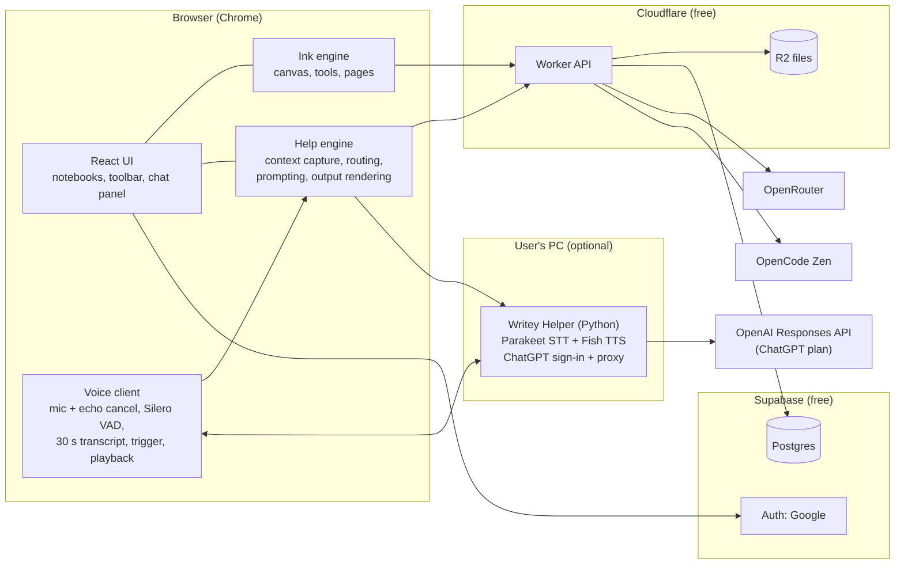
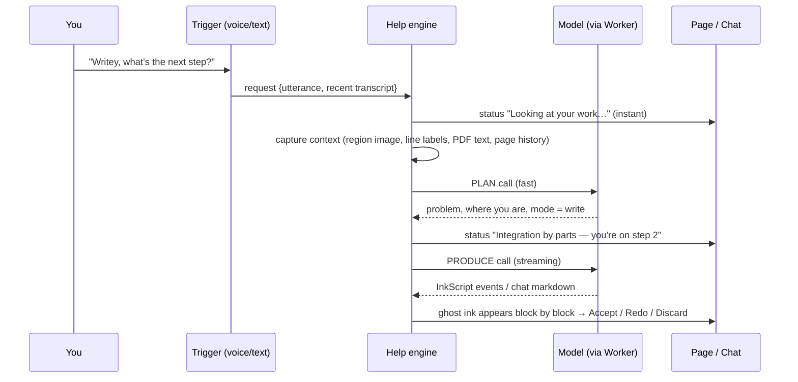

# Writey — Architecture

> A handwritten notebook for math and physics with an AI you talk to.
> Say "Writey, what's next?" and it continues your work in handwriting on the page.
> Say "Writey, why does this work?" and it explains in a side chat.

Status: **v0.6** (2026-10-25). Open-source, multi-user, $0 hosting; users bring their own AI keys.

v0.2 changes: Gemini Live dropped (voice is local only, via Writey Helper); ChatGPT sign-in settled as Helper-only; push-to-talk added; ChatGPT merged into the Helper phase. v0.3: voice runs on local Python models (Parakeet STT, Fish S1-mini TTS); the browser owns mic, VAD and playback, the Helper only runs models. v0.4: Phase 2 shipped; key storage goes through two security-definer functions instead of the service role (§6.2). v0.5: Sign in with ChatGPT shipped early in Writey Helper, following OpenAI's documented open-source flow (§6.3). v0.6: Phases 3 and 4 shipped: handwriting in EMS Allure with Writey's own math layout (§5.5), ghost ink (§5.7), and local voice with Parakeet + Kokoro (§7.3); Fish S1-mini waits on its gated weights. Running decisions log: [HANDOFF.md](../HANDOFF.md).

---

## 1. Decisions at a glance

| Area                     | Decision                                                                                                                                                                                                     |
| ------------------------ | ------------------------------------------------------------------------------------------------------------------------------------------------------------------------------------------------------------ |
| Platform                 | Web app in Chrome on desktop (laptop + pen tablet, e.g. Huion). iPad later.                                                                                                                                  |
| Frontend                 | React + TypeScript + Vite. Custom canvas engine (no tldraw/Excalidraw).                                                                                                                                      |
| Backend                  | One Cloudflare Worker (Hono): serves the app, verifies auth, proxies AI calls, stores files.                                                                                                                 |
| Database + auth          | Supabase free tier: Postgres + Google login.                                                                                                                                                                 |
| File storage             | Cloudflare R2 free tier (10 GB): PDFs, images, page ink blobs.                                                                                                                                               |
| AI providers (thinking)  | **OpenRouter** (user key), **OpenCode Zen** (user key), **ChatGPT plan** (Sign in with ChatGPT). Nothing else.                                                                                               |
| Voice                    | **Local models via Writey Helper** (Python): Parakeet TDT 0.6B v2 speech-to-text, Fish OpenAudio S1-mini text-to-speech. Browser owns mic, VAD, playback. Plus a **text box**. No cloud voice. English only. |
| Talking to Writey        | Say "Writey, …" (detected in the transcript) **or** hold a push-to-talk key / pen-tablet button.                                                                                                             |
| Default reasoning model  | DeepSeek V4.1 Flash (native vision) via OpenRouter, user-changeable.                                                                                                                                         |
| Assistant name / trigger | "Writey".                                                                                                                                                                                                    |
| AI output                | Chat panel **or** handwritten ink on the page, chosen by intent. Both link to each other.                                                                                                                    |
| AI ink                   | Distinct color, grouped (erasable as one), shown as a ghost preview with **Accept / Redo / Discard**.                                                                                                        |
| Memory                   | One conversation per page. Nothing global.                                                                                                                                                                   |
| Proactive help           | None in v1. Writey acts only when asked.                                                                                                                                                                     |
| Paper                    | Plain white in v1; background system built so v2 can add paper styles.                                                                                                                                       |
| Sharing                  | v2.                                                                                                                                                                                                          |

---

## 2. System overview



The **help engine runs in the browser**: it already has the canvas, so it can render exactly the region the AI needs to see. The Worker is a thin, low-CPU layer. It checks who you are, adds your decrypted API key to the request, and streams the response back.

---

## 3. Repository layout

```
writey/
  apps/
    web/              React app (UI, routing, state)
    worker/           Cloudflare Worker (Hono) — API + static asset hosting
    helper/           Writey Helper — Python (FastAPI), runs on user's PC
  packages/
    ink-engine/       Canvas engine: document model, rendering, tools, undo
    inkscript/        AI ink format: parser, layout, handwriting + diagram renderer
    ai-core/          Context capture, prompts, intent routing, provider adapters
    shared/           Types + zod schemas shared by web and worker
  supabase/
    migrations/       SQL schema + RLS policies
  docs/
```

pnpm workspaces. `ink-engine`, `inkscript` and `ai-core` are plain TypeScript with no React, so they can be unit-tested and reused in an iPad app later.

---

## 4. Notebook and ink engine

### 4.1 Document model

```
Notebook  { id, title, pages[] (ordered) }
Page      { id, size (pt), background, items[], version }
Background{ kind: 'blank' | 'pdf' | 'image', assetId?, pdfPage?, style? }   // style used in v2
Item =
  | Stroke    { id, tool, color, width, points: Float32Array [x,y,t...], author: 'user'|'ai', groupId? }
  | ImageItem { id, assetId, rect }
  | TextItem  { id, rect, text }                      // typed text box
  | AIGroup   { id, messageId, source: InkScript, strokeIds[], status: 'ghost'|'accepted' }
```

- Units are PDF points (1/72 inch). Default page is A4 (595 × 842).
- `AIGroup` keeps the AI's original source (LaTeX, text, diagram spec). That gives grouped erase, "why?" on any AI step, and exact re-reading of AI work without OCR.
- Pressure is ignored in v1 (basic pen), as requested. Points still record time so speed can thin lines slightly for a natural look.

### 4.2 Rendering

Three stacked canvases per visible page:

1. **Background**: white or the PDF/image page, rendered by pdf.js and cached per zoom level.
2. **Ink**: committed strokes and AI ink, re-rendered only on change, tiled for big zoom.
3. **Wet ink**: the stroke being drawn right now. It uses `getCoalescedEvents()` and a `desynchronized` 2D context for minimum pen latency.

Strokes are turned into smooth outlines with `perfect-freehand`. Pages virtualize: only pages near the viewport are mounted.

### 4.3 Input

Pointer Events. The Huion tablet appears as `pointerType: 'pen'` when Windows Ink is enabled in the Huion driver, or as `mouse` otherwise. Both work, since pressure is unused. Keyboard shortcuts cover every tool.

### 4.4 Tools

| v1                                                  | v1.x                                  | v2                                     |
| --------------------------------------------------- | ------------------------------------- | -------------------------------------- |
| Pen (3 presets + color picker)                      | Partial (pixel) eraser                | Paper styles: lined, grid, dot, colors |
| Highlighter                                         | Shape recognition (hold to snap)      | Ruler / protractor                     |
| Stroke eraser                                       | Export page/notebook as PDF, PNG, SVG | Handwriting learned from the user      |
| Lasso: move, resize, delete, recolor, copy/paste    | Page templates                        | Sharing                                |
| Undo / redo (per page)                              | Search notebook text                  | iPad / Apple Pencil                    |
| Text box                                            |                                       |                                        |
| Insert image, import PDF (each page becomes a page) |                                       |                                        |
| Add / delete / reorder pages, zoom, pan             |                                       |                                        |
| Notebook library                                    |                                       |                                        |

Undo uses a command stack per page. Accepting AI ink is one command, so a single undo removes it.

### 4.5 Saving

- Edits update the in-memory page immediately and mark it dirty.
- After 1.5 s of idle (and on page leave or tab hide), the page is serialized, gzip-compressed and `PUT` to the Worker. The Worker writes it to R2 and bumps `pages.version` in Postgres.
- Optimistic concurrency: a save carries the version it was based on. A mismatch (the same notebook open in two tabs) asks which copy to keep. Real-time multi-device merging comes with sharing in v2.
- An unsaved-changes buffer in IndexedDB survives a crash or closed tab.

---

## 5. The help engine (the core)

Every request goes through the same pipeline, whether it started from voice, the Helper or the text box.



### 5.1 Context capture (what the AI sees)

1. **Focus region.** A lasso selection wins. Otherwise, cluster strokes written in the last ~60 s into a box, then extend upward to the problem statement. That's the nearest PDF text block or the first block of ink above a whitespace gap. The box is clamped to the page.
2. **Line labels.** Ink in the region is grouped into lines, and each gets a small numbered tag (`L1`, `L2`, …) drawn on the image sent to the model, but never on your page. The model refers to "line L3" instead of guessing pixel coordinates. This is what makes "circle my mistake" and "write below line 4" precise.
3. **Images sent:** the focus region at up to 1344 px on the long side, plus a small thumbnail of the whole page.
4. **Text sent:** PDF text inside the region (from pdf.js), exact sources of AI ink already on the page (LaTeX/text), the page conversation history, and the last ~30 s of what you said.

### 5.2 Intent routing: chat or ink?

Modes: `write` (ink), `explain` (chat), `check` (red marks plus chat), `both` (short ink plus a chat explanation).

1. **Rules first (instant, free):**
   - "continue", "next", "what's next", "solve", "show me", "finish", "write it" → `write`
   - "why", "how does", "explain", "don't understand", "what is" → `explain`
   - "check", "is this right", "mistake", "wrong" → `check`
2. **Otherwise the PLAN call decides.** If it's still unsure, it picks `explain`. Chat never dirties your page, and every chat answer has a **"Write this on the page"** button.
3. **Overrides:** "just explain", "write it", "just show me the answer", "only a hint".
4. **Tutor vs solver** comes from the wording: "hint" or "how do I" means one step or nudge, while "solve" or "show me the answer" means a full solution.

### 5.3 The two calls

- **PLAN** (small, fast, JSON): `{problem, user_progress, mode, scope: hint|next_step|full, target_line, status_line}`. Its `status_line` is shown and spoken (if voice replies are on). That's the "tell me what you're doing" part.
- **PRODUCE** (streaming):
  - `explain` → Markdown with KaTeX math in the chat panel.
  - `write` / `check` / `both` → **InkScript** (below), one JSON object per line. Each block renders as soon as its line arrives.

Not every model supports strict JSON mode. The prompts carry the format and examples, and the parser tolerates bad lines: it skips a malformed line and asks for a repair once.

### 5.4 InkScript: the AI's drawing language

```jsonc
{"type":"status","text":"Writing step 3"}
{"type":"text","text":"Let u = x, dv = eˣ dx","after":"L4"}
{"type":"math","latex":"\\int x e^x\\,dx = x e^x - \\int e^x\\,dx","after":"prev"}
{"type":"math","latex":"= e^x(x-1) + C","after":"prev","box":true}
{"type":"mark","kind":"circle","target":"L3","note":"sign error: -(-2) = +2"}
{"type":"diagram","after":"prev","spec":{ /* see 5.6 */ }}
{"type":"done","summary":"Finished using integration by parts"}
```

- **Placement:** `after: "L4"` means below line 4. The layout engine finds the next free vertical space under that line inside the focus column. If there's no room, it uses the nearest empty area, then the next page.
- **Marks** (`circle`, `underline`, `arrow`, `cross`, `tick`) attach to line labels and draw in red.

### 5.5 Handwriting renderer (style A)

Goal: AI ink that looks hand-drawn and animates stroke by stroke.

- **Text:** a _single-line_ (centerline) handwriting font, Hershey Script or a similar SIL/OFL single-stroke font, so each letter is a pen path instead of a filled outline.
- **Math:** MathJax lays out the LaTeX: positions, sizes, fraction bars and radicals. Each glyph is then swapped for its single-stroke equivalent. Hershey fonts include Greek letters and math symbols (∫ Σ √ ∂ ∞ …), and missing ones get hand-authored glyphs. Bars and radical signs become drawn lines.
- **Natural look:** slight per-glyph jitter in position, size and baseline, plus per-stroke timing so it writes at a human-ish speed. Animation can be skipped with a click.
- **Fallback:** a glyph with no single-stroke version renders as a filled outline and appears with a fade-in.
- Style B (your own handwriting) later replaces the glyph source only. Nothing else changes.

> **Risk spike, done 2026-10-25:** 20 typical formulas rendered and judged.

**As built (`packages/inkscript`):** the text font is **EMS Allure** (single-stroke cursive, SIL OFL); Greek and math
symbols come from Hershey, scaled to Allure's x-height and digit height; a few symbols are composed. Instead of MathJax,
math goes through Writey's own small LaTeX parser and TeX-like box layout (`latex.ts`, `layout.ts`): Allure's metrics
don't match Computer Modern, and drawing fraction bars, radicals and stretchy brackets ourselves keeps them hand-drawn.
Per-glyph jitter is seeded, so Redo writes differently. Paths become pen strokes timed at about twice a calm hand's speed
(`hand.ts`), placed by `place.ts` and animated by the page controller. The writing size follows the student's line height.

### 5.6 Diagrams

The model never draws pixels. It writes a small spec, and Writey draws it in the same hand-drawn pen style:

```jsonc
{
  "frame": { "w": 220, "h": 160 }, // points, positioned by layout engine
  "items": [
    { "axes": { "x": [-1, 7], "y": [-2, 2], "ticks": 1, "labels": ["x", "y"] } },
    { "plot": { "expr": "sin(x)", "domain": [0, 6.283], "label": "y = sin x" } },
    { "point": { "at": [3.14159, 0], "label": "π" } },
    { "rect": { "at": [10, 60], "w": 40, "h": 30, "label": "m" } },
    { "arrow": { "from": [50, 75], "to": [110, 75], "label": "F = 10 N" } },
    { "angle": { "vertex": [0, 0], "from": [1, 0], "to": [0.7, 0.7], "label": "θ" } }
  ]
}
```

Primitives: `line, arrow, vector, polyline, polygon, rect, circle, ellipse, arc, angle, axes, plot (evaluated with math.js, sampled adaptively), point, label (text or LaTeX), dimension, hatch (ground/wall), spring, pulley`. Diagrams stay editable objects (move, scale, delete) and export as SVG.

### 5.7 Ghost preview and accept

AI ink first appears as a faint ghost (40% opacity) with a floating bar: **Accept · Redo · Discard · Why?**. Saying "Writey, keep it" or "redo that" works too. Accepting turns it into normal AI-colored ink, still grouped. **Why?** opens the chat with that step's explanation.

### 5.8 Memory

Each page has one thread (`ai_threads` / `ai_messages`). A request includes the last ~10 turns, summarized beyond that. AI ink already on the page is passed as exact source, so "why did you do that last step?" works. Nothing carries across pages.

---

## 6. AI providers

### 6.1 Adapter interface (`packages/ai-core`)

```ts
interface ProviderAdapter {
  id: 'openrouter' | 'opencode-zen' | 'chatgpt'
  listModels(): Promise<ModelInfo[]> // filtered to image-capable models
  stream(req: {
    model: string
    system: string
    messages: Msg[] // text + image parts
    json?: boolean
  }): AsyncIterable<StreamEvent> // text deltas, done, usage, error
}
```

Two wire formats cover all three:

| Provider     | Wire format                                                                                                   | Auth                                          | Model list                                |
| ------------ | ------------------------------------------------------------------------------------------------------------- | --------------------------------------------- | ----------------------------------------- |
| OpenRouter   | Chat Completions                                                                                              | User API key (stored encrypted)               | `/api/v1/models`, filtered on image input |
| OpenCode Zen | Chat Completions, or Responses for GPT models                                                                 | User API key (stored encrypted)               | `/zen/v1/models`                          |
| ChatGPT plan | Responses API (`store:false`, `stream:true`, no `temperature` / `max_output_tokens`, full history every call) | Sign in with ChatGPT, via Writey Helper (6.3) | Models available to the token             |

Settings let the user pick a provider and model for **reasoning** (PLAN and PRODUCE). An optional cheaper model can handle PLAN only.

### 6.2 Key storage

- Keys are sent once over HTTPS to the Worker, encrypted with **AES-256-GCM** (master key is a Worker secret; random IV per row; AAD = `user_id|provider`) and stored in `provider_credentials`.
- The Worker never holds the service-role key. It talks to Postgres as the signed-in user, and RLS plus column grants let clients see only provider, label, last 4 characters and created date. The ciphertext columns are reachable only through two `security definer` functions, `save_provider_secret()` and `provider_secret()`, which act on `auth.uid()`'s own row. A user could call them directly, but all they get is their own ciphertext, useless without the master key.
- A `key_version` column allows rotating the master key.

### 6.3 ChatGPT plan: how it fits the rules

Research findings (Oct 2026):
- **Open-source projects** get plan usage **self-serve**, but that flow is built for apps running on the user's machine. It uses a loopback redirect to `http://127.0.0.1:1455/auth/callback` and stores tokens locally.
- The **hosted website** flow needs an OpenAI-issued client ID (waitlist / limited trial).
- Images and function tools are supported. Hosted tools, `previous_response_id` and audio input are not.

**Decision:** the ChatGPT provider lives in **Writey Helper**. The Helper runs the loopback sign-in, keeps the tokens on the user's PC (owner-only file permissions, refreshed hourly), and proxies Responses API calls from the browser. That stays inside the self-serve open-source flow.

Consequence: ChatGPT (and voice) need the Helper installed; OpenRouter and OpenCode Zen work from the website alone. Moving ChatGPT tokens into Supabase and calling OpenAI from the Worker would be a hosted integration that needs an OpenAI-issued client ID. Revisit only if one is granted.

**As built (2026-10-25), per developers.openai.com/siwc/token-sharing-open-source:**

- **Registration:** the first sign-in opens `https://auth.openai.com/api/accounts/authorize` with `client_id=dynamic_agent_client`, `agent_name_hint=Writey` and a per-computer `ext_agent_host_id` (`urn:uuid:…`, made once). The callback returns the issued `oaiapp_…` client id, which is saved and reused for later sign-ins (with `id_token_hint` / `login_hint`).
- **OAuth details:** PKCE S256, `state` and `nonce`. Scopes are `openid profile email offline_access resource.invoke chatgpt.tokens.use.direct`, with `resource=https://api.openai.com/v1`. The callback listens on `http://127.0.0.1:1455/auth/callback`, falling back to any free port. Codes are exchanged at `/api/accounts/oauth/token`. The ID token is verified against OpenAI's JWKS (issuer, audience = issued client id, nonce).
- **Tokens:** they live in the Helper's per-user folder (atomic, owner-only writes). The access token lasts 1 h and the rotating refresh token 30 days; refreshes are serialized. Sign-out revokes the refresh token at the discovery `revocation_endpoint` and keeps the registration.
- **Inference:** `POST https://api.openai.com/v1/responses` with `store:false` and `stream:true`. System text goes in `instructions`, and images as `input_image`. The Helper strips forbidden parameters (`temperature`, `max_output_tokens`, …). Only `response.completed` counts as success. Plan-usage error codes map to plain messages, with a **Manage usage** link (https://chatgpt.com/settings/usage).
- **Browser ↔ Helper:** no pairing. "Continue with ChatGPT" is a plain link: the tab goes to the Helper's `GET /chatgpt/connect?return_to=…` (only Writey pages are accepted as `return_to`), which 303s to OpenAI; OpenAI calls back to `127.0.0.1:1455`, and the Helper 303s the tab back to Writey with `?chatgpt=connected` (or `=error`). Other endpoints need an allowed `Origin` and `Host: 127.0.0.1:47823` (which blocks DNS rebinding); browsers always send `Origin` on these cross-origin calls. Preflights send `Access-Control-Allow-Private-Network`. The website contacts 127.0.0.1 only after you first click Continue with ChatGPT, so other users never see Chrome's local-network prompt. `/health` reports an `api` level so Writey can ask for an update when the Helper is too old.
- **UI rules followed:** the button says "Continue with ChatGPT". A one-time "You’re using your ChatGPT plan" notice appears, and "Using ChatGPT plan · Manage usage" shows next to the composer.

### 6.4 Model capabilities, errors, cancel

- **Vision check.** The help engine sends images, so the reasoning model must accept image input. Model pickers mark text-only models. If a text-only model is chosen, a two-step path runs: a vision model transcribes the focus region line by line to text/LaTeX (cached per line), then the chosen model reasons over that text.
- **Errors** are mapped to plain messages: bad key (401), out of credits (402), rate limit (429), request too large, model not found. Never a silent failure.
- **Usage:** tokens and cost (OpenRouter returns cost) are saved in `ai_messages.usage` and shown per request.
- **Cancel:** a stop button and "Writey, stop" abort the stream end to end (browser `AbortController` → Worker → provider, or → Helper for ChatGPT).
- **OpenRouter connect:** a "Connect OpenRouter" button uses OpenRouter's OAuth PKCE flow instead of pasting a key.

---

## 7. Voice

All voice is **local**: models run on the user's PC in Writey Helper. No audio leaves the PC; only transcript text goes to the reasoning model. English only.

### 7.1 Who does what

| Browser (voice client in `apps/web`)                                                           | Writey Helper (Python, `127.0.0.1:47823`)                     |
| ---------------------------------------------------------------------------------------------- | ------------------------------------------------------------- |
| Mic via `getUserMedia({ echoCancellation, noiseSuppression })`, 16 kHz mono in an AudioWorklet | **STT:** speech segment (PCM) in → text out (Parakeet)        |
| **Silero VAD** (ONNX in a Web Worker): only speech segments are sent; silent room = nothing    | **TTS:** text in → audio out (Fish S1-mini), streamed         |
| 30-second rolling transcript (yours + Writey's replies as text)                                | **ChatGPT:** loopback sign-in, token storage, Responses proxy |
| Trigger check ("Writey …"), push-to-talk, listening toggle, mic indicator                      | Health / model status, first-run model download               |
| Plays TTS audio through the page, so Chrome's echo canceller removes it from the mic           |                                                               |

Why this split: Chrome's echo cancellation stops Writey hearing itself for free; no Python audio-device code; one mic permission and indicator; the Helper is stateless (restart anytime); the help engine and transcript already live in the browser.

```ts
interface VoiceSource {
  start(): Promise<void>
  stop(): void
  onTranscript(cb: (t: { text: string; final: boolean }) => void): void
  onRequest(cb: (r: HelpRequest) => void): void // fired when Writey is addressed
  speak?(text: string): Promise<void> // only if voice replies are on
}
```

Sources: **Helper voice** (when running) and the **text box** (always available: Ctrl+K, or click the Writey button). If the Helper isn't running, the app shows "Voice off — start Writey Helper" and the text box.

### 7.2 Pipeline

1. Mic frames → Silero VAD. No speech → nothing happens (no transcription, no network).
2. Speech starts → buffer the segment; speech ends (~300 ms silence) → send the segment over the WebSocket.
3. Helper runs Parakeet (well under 100 ms on GPU) → returns text.
4. Browser appends it to the 30 s transcript and checks the trigger:
   - **Push-to-talk** held → always a request.
   - Sentence contains **"Writey"** near the start (fuzzy: "righty", "ready", "writy") → request.
   - Low-confidence match → "Did you mean Writey?" chip instead of acting.
5. Request → help engine (§5) with the utterance + the 30 s transcript + page context.
6. If voice replies are on, the status line / short answer → Helper TTS → played in the page. Writey's spoken text is appended to the transcript **as text**; it is never re-transcribed.
7. You start speaking while Writey talks → playback stops (barge-in).

### 7.3 Writey Helper (local Python, free)

```
apps/helper/
  writey_helper/
    server.py        FastAPI: WS /stt, POST /tts (streamed audio), /chatgpt/*, GET /health
    stt.py           Parakeet TDT 0.6B v2 via onnx-asr (ONNX Runtime CUDA; CPU fallback). Fallback model: faster-whisper distil-large-v3
    tts.py           Fish Audio OpenAudio S1-mini (local, CUDA). Fallback: Kokoro-82M
    chatgpt.py       Sign in with ChatGPT (dynamic registration, loopback 127.0.0.1:1455) + Responses proxy  ✅
    autostart.py     `writey-helper install`: start hidden at Windows sign-in (HKCU Run key)
    models.py        download + cache model weights on first run, report status
  pyproject.toml     installed with `uv`; one command to run (`uv run writey-helper`)
```

- **As built (Helper 0.3.0):** `speech.py` serves `POST /stt` (one 16 kHz 16-bit PCM segment → text), `POST /tts` (text → WAV), `GET /voice/status` and `POST /voice/prepare` (download with progress, then load in the background). Parakeet runs as int8 ONNX via onnx-asr and Kokoro-82M as int8 ONNX via kokoro-onnx, both on CPU with 6 threads and a warm-up run. Fish S1-mini is not shipped: its weights are gated on Hugging Face and need PyTorch. The browser side is `apps/web/src/voice` (Silero VAD v5 via `@ricky0123/vad-web`, assets served under `/vad/`); push-to-talk is the backquote key.
- **Models:** Parakeet TDT 0.6B v2 (English-only, fastest, more accurate than Whisper large-v3, doesn't invent text in silence; ~2 GB VRAM). Fish OpenAudio S1-mini (0.5B; weights are CC BY-NC-SA, non-commercial; users download them on first run). Measure S1-mini latency and VRAM early; Kokoro-82M is the light fallback.
- **Security:** binds to 127.0.0.1 only and answers only the Writey site's origins (Host and Origin checks). Chrome asks once for Local Network Access permission.
- **Listening toggle** in the toolbar, auto-paused after 10 minutes of silence; mic indicator whenever the mic is open.
- **Later:** an openWakeWord "Writey" model if transcript matching misses too often; opt-in "study mode" (responds when you sound stuck); packaging the Helper + app as a desktop app (Electron/Tauri) with no change to this split.

### 7.4 Text box

Same help engine, typed instead of spoken. Ctrl+K opens it at the pen position.

---

## 8. Backend: Cloudflare Worker

One Worker serves the built React app (static assets) and these routes:

| Route                                                           | Purpose                                                                                                                                                                                         |
| --------------------------------------------------------------- | ----------------------------------------------------------------------------------------------------------------------------------------------------------------------------------------------- |
| `POST /api/ai/:provider/chat`                                   | Check the Supabase JWT, decrypt the key, forward the body to an allow-listed provider URL, stream the response back. The body passes through unparsed to stay within the free plan's CPU limit. |
| `GET /api/ai/:provider/models`                                  | Model list (cached 1 h).                                                                                                                                                                        |
| `GET /api/credentials`, `PUT/DELETE /api/credentials/:provider` | List key metadata; save (OpenRouter keys are checked first) or delete an encrypted key.                                                                                                         |
| `PUT/GET /api/pages/:id/content`                                | Page ink blobs in R2, with version check.                                                                                                                                                       |
| `POST /api/assets` → signed R2 upload                           | PDF and image uploads (size-limited).                                                                                                                                                           |

The free plan allows 100k requests a day and about 10 ms CPU per request, so the Worker never parses big bodies. Supabase JWTs are verified against Supabase's JWKS, cached.

---

## 9. Data model (Supabase Postgres)

```sql
profiles             (id uuid pk = auth.uid, display_name, settings jsonb, created_at)
notebooks            (id, owner_id, title, sort_key, created_at, updated_at, deleted_at)
pages                (id, notebook_id, owner_id, sort_key, width, height,
                      background jsonb, content_key text,  -- R2 object key
                      version int, updated_at, deleted_at)
assets               (id, owner_id, kind 'pdf'|'image', r2_key, bytes, sha256, page_count, created_at)
ai_threads           (id, page_id, owner_id, summary text, updated_at)
ai_messages          (id, thread_id, role, content jsonb, model, usage jsonb, created_at)
provider_credentials (id, owner_id, provider, label, ciphertext bytea, iv bytea,
                      key_version int, last4 text, created_at)
```

- RLS: `owner_id = auth.uid()` on every table. `provider_credentials` has no client policies at all (Worker only).
- `sort_key` is a fractional index string, so reordering pages touches one row.
- Soft deletes (`deleted_at`), giving a Trash with 30-day restore.
- Sharing (v2) adds `notebook_members(notebook_id, user_id, role)` and widens policies. Nothing else changes.

---

## 10. Free-tier limits to watch

| Service                 | Limit                                           | Effect                                                     |
| ----------------------- | ----------------------------------------------- | ---------------------------------------------------------- |
| Supabase free           | Pauses after 7 days with no activity; 500 MB DB | One-click unpause. Ink lives in R2, so the DB stays small. |
| Cloudflare Workers free | 100k requests/day, ~10 ms CPU per request       | Passthrough proxy, debounced saves.                        |
| R2 free                 | 10 GB storage, 1M writes/month                  | Gzipped pages are small; saves are debounced.              |

---

## 11. Build phases

Each phase ends with something usable.

| Phase                | Delivers                                                                                                                                                                                                  | Status                          |
| -------------------- | --------------------------------------------------------------------------------------------------------------------------------------------------------------------------------------------------------- | ------------------------------- |
| **0. Foundations**   | Monorepo, Supabase project with Google login, Worker deployed on workers.dev, CI.                                                                                                                         | ✅ shipped                      |
| **1. Notebook**      | Ink engine, v1 tools, pages, notebooks, save/load, PDF and image import. A full notebook app without AI.                                                                                                  | ✅ shipped                      |
| **1b. Math spike**   | Render ~20 typical formulas with the single-stroke handwriting renderer (§5.5) and judge quality.                                                                                                         | ✅ done                         |
| **2. Ask by typing** | Provider settings (OpenRouter, OpenCode Zen) with encrypted keys, context capture with line labels, PLAN/PRODUCE, chat panel with KaTeX, cancel, errors, vision check. Model eval set (20–30 real pages). | ✅ shipped (eval set pending)   |
| **3. Writey writes** | InkScript, layout engine, handwriting renderer, ghost preview and accept, check-my-work marks.                                                                                                            | ✅ shipped                      |
| **4. Helper**        | Browser voice client (mic, VAD, transcript, trigger, push-to-talk) + Writey Helper (Parakeet STT, Fish TTS) **and** Sign in with ChatGPT + Responses adapter (same process).                              | ✅ shipped (Kokoro TTS for now) |
| **5. Diagrams**      | Diagram spec, renderer, plots, SVG export.                                                                                                                                                                |                                 |
| **v1.x / v2**        | Exports, shape snapping, paper styles, study mode, sharing, personal handwriting style, iPad.                                                                                                             |                                 |

---

## 12. Risks and mitigations

| Risk                                    | Mitigation                                                                                                            |
| --------------------------------------- | --------------------------------------------------------------------------------------------------------------------- |
| Handwritten math looks bad              | Spike in Phase 1; outline-font fallback; tune jitter.                                                                 |
| Vision model misreads messy handwriting | Test DeepSeek V4.1 Flash on real samples early; model is swappable per user; line labels reduce the precision needed. |
| Model places marks in the wrong spot    | Line labels (set-of-marks) instead of pixel coordinates.                                                              |
| "Writey" misheard                       | Push-to-talk, fuzzy transcript match, confirm chip; add an openWakeWord model only if misses are common.              |
| Writey hears its own TTS                | Mic gated / echo-cancelled while speaking; barge-in stops playback.                                                   |
| Helper on PCs without an NVIDIA GPU     | Parakeet ONNX on CPU (slower, still usable) or Kokoro TTS; push-to-talk works everywhere.                             |
| STT + TTS + canvas share an 8 GB GPU    | Parakeet ~2 GB; measure S1-mini early; fall back to Kokoro-82M if too slow or too big.                                |
| ChatGPT plan terms for hosted apps      | Helper-only until a hosted client ID is granted.                                                                      |
| Free-tier pauses or limits              | Section 10; nothing stored only in the DB that can't be recovered.                                                    |
| Pen latency                             | Wet-ink canvas, coalesced events, desynchronized context.                                                             |

---

## 13. Open questions

None right now.

Resolved: voice via local Python models with the browser ↔ Helper split (§7, HANDOFF D21); browser-only voice rejected; English only; STT Parakeet TDT 0.6B v2, TTS Fish OpenAudio S1-mini (HANDOFF D19); "OpenCode" = OpenCode Zen; no Gemini (voice is local only); ChatGPT is Helper-only; license is MIT; product and repo name are "Writey".
